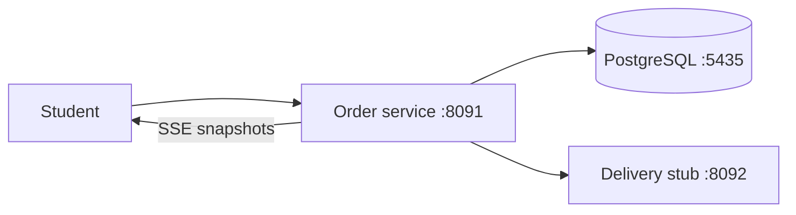

# 27 · Order and delivery tracking

> Place an order and show its delivery progress to the class.

## The shop example

- The order service is the shop counter and saves orders with audit records.
- The delivery service is a local stub that returns a fifteen-minute ETA.
- PostgreSQL keeps the order state after an application restart.
- SSE shows changed status snapshots while the customer stays connected.



## What to read

- [Order service guide](order-service/README.md) explains code, tests, transactions, security, and limits.
- [Delivery service guide](delivery-service/README.md) explains the independently runnable stub.
- [Compose configuration](compose.yaml) connects both services to local infrastructure.
- [Earlier lessons](../ROADMAP.md) explain each feature separately.

## Before you start

- Use JDK 17 or newer and a running Docker engine.
- Set disposable teaching credentials in your current terminal.
- Ports 8091, 8092, and 5435 must be available.

## Build and start everything

**Windows PowerShell**

```powershell
$env:DB_PASSWORD = "classroom-local-only"
$env:DEMO_PASSWORD = "local-demo-only"
.\mvnw.cmd verify
docker compose up --build -d
docker compose logs -f order-service
```

**macOS / Linux**

```bash
export DB_PASSWORD=classroom-local-only
export DEMO_PASSWORD=local-demo-only
sh mvnw verify
docker compose up --build -d
docker compose logs -f order-service
```

- Wait for the order service startup message before sending requests.
- Open http://localhost:8091/actuator/health and http://localhost:8092/actuator/health to check readiness.
- Open http://localhost:8091/orders and enter the local student credentials when the browser prompts.
- Ctrl+C stops log following while the containers keep running.

## Classroom walkthrough — PowerShell

```powershell
$pair = [Convert]::ToBase64String([Text.Encoding]::UTF8.GetBytes("student:$env:DEMO_PASSWORD"))
$headers = @{ Authorization = "Basic $pair"; "X-Request-Id" = "classroom-27" }
$order = Invoke-RestMethod http://localhost:8091/orders -Method Post -Headers $headers -ContentType application/json -Body '{"product":"tea","quantity":2}'
$order
Invoke-RestMethod "http://localhost:8091/orders/$($order.id)/delivery" -Headers $headers
```

- Copy the generated order ID into the next command and watch it in another terminal.

```powershell
curl.exe -N -u student:local-demo-only http://localhost:8091/orders/1/events
```

- Replace `1` with the generated ID because existing database data changes the next ID.
- Keep the first terminal open because it holds `$order` and `$headers`.

```powershell
Invoke-RestMethod "http://localhost:8091/orders/$($order.id)/status" -Method Patch -Headers $headers -ContentType application/json -Body '{"status":"PACKED"}'
```

- Wait at least one second before repeating the PATCH for `OUT_FOR_DELIVERY` and then `DELIVERED`.

## Classroom walkthrough — macOS / Linux

```bash
curl -i -u "student:$DEMO_PASSWORD" http://localhost:8091/orders -H 'Content-Type: application/json' -H 'X-Request-Id: classroom-27' -d '{"product":"tea","quantity":2}'
```

- Copy the response ID into `ORDER_ID` below.

```bash
ORDER_ID=1
curl -u "student:$DEMO_PASSWORD" "http://localhost:8091/orders/$ORDER_ID/delivery"
curl -N -u "student:$DEMO_PASSWORD" "http://localhost:8091/orders/$ORDER_ID/events"
```

- In another terminal, set the same password and order ID before updating the order.

```bash
export DEMO_PASSWORD=local-demo-only
ORDER_ID=1
curl -X PATCH -u "student:$DEMO_PASSWORD" "http://localhost:8091/orders/$ORDER_ID/status" -H 'Content-Type: application/json' -d '{"status":"PACKED"}'
```

- Wait at least one second and repeat with `OUT_FOR_DELIVERY` and then `DELIVERED`.

## Expected results and request flow

1. Security validates the Basic credentials and the filter adds a request ID.
2. Validation rejects blank products and non-positive quantities with HTTP 400.
3. OrderService saves an order and audit row in one transaction after WebFlux subscribes.
4. POST returns HTTP 201 with a generated ID and status `CREATED`.
5. The delivery route returns `etaMinutes: 15` from the local HTTP stub.
6. Each valid PATCH commits the next status and its audit row.
7. SSE emits observed changes and completes when it sees `DELIVERED`.
8. Disconnecting from SSE cancels that client's polling chain.

## Test it

- `mvnw verify` runs routine tests for both services without Docker.
- The order-service database checks require PostgreSQL and the integration profile.

```powershell
.\mvnw.cmd -f order-service/pom.xml -Pintegration verify
```

```bash
sh mvnw -f order-service/pom.xml -Pintegration verify
```

- The commands above use the mapped PostgreSQL port 5435 and the current DB_PASSWORD.
- http://localhost:8091/actuator/metrics/classroom.orders.created reports the classroom order counter with authentication.

## Run services independently

- Start only PostgreSQL with `docker compose up -d --wait postgres` from this folder.
- Start the stub from `delivery-service` with its wrapper and `spring-boot:run` on port 8092.
- Start the order service from `order-service` with its wrapper and `spring-boot:run` on port 8091.
- Both Java processes are independent and share no source dependencies.
- Avoid running the sibling PostgreSQL Compose file while the parent stack already owns port 5435.

## Common problems and limitations

- A missing password stops startup with an actionable error rather than using a committed secret.
- If the delivery stub is stopped, the ETA route retries safe reads and then returns `ETA_PENDING`.
- A missing order returns 404 and an out-of-order status transition returns 409.
- A stale concurrent update returns 409 through optimistic locking.
- SSE polls once per second for up to two minutes and can miss intermediate changes between polls.
- Reconnecting reads the latest durable state but does not replay a durable event history.
- An in-memory sink would lose history on restart and would not broadcast across application instances.
- Every connected stream adds database reads, so production needs measured limits or durable event distribution.
- POST has no idempotency-key store, so manually retrying creation can duplicate an order.
- Database transactions do not cover the delivery HTTP service.
- HTTP Basic and disabled CSRF are limited to the stateless local command-line teaching flow.

## Exercise

- **Task:** Stop the delivery stub and predict the ETA response.
- **Hint:** The database order should still exist because the ETA read is outside its transaction.

<details>
<summary>Show the solution</summary>

- Run `docker compose stop delivery-service` and request the ETA to see `ETA_PENDING`.
- Run `docker compose start delivery-service` to restore normal replies.

</details>

## Interview FAQs

**Why are database writes and HTTP calls separated?**

- A local database transaction cannot atomically commit an unrelated HTTP service.

**Why retry ETA reads but not order creation?**

- A read can be safely repeated while an unprotected create request may duplicate a business action.

**What makes this more than returning Mono from a controller?**

- The HTTP client, persistence driver, and composed request path use reactive APIs without blocking request threads.

**What is still needed for production?**

- Add managed authentication, TLS, migrations, durable event delivery, idempotency, tracing export, capacity testing, and environment-specific operations.

## Stop and clean up

```bash
docker compose down
```

- Run `docker compose down -v` only when you want to erase this capstone's database volume.
- No image push or cloud deployment is needed for the classroom demo.

- You have reached the final practical lesson.

## Official references

- [Reactive transactions](https://docs.spring.io/spring-framework/reference/data-access/transaction/programmatic.html).
- [WebClient](https://docs.spring.io/spring-framework/reference/web/webflux-webclient.html).
- [Reactive security](https://docs.spring.io/spring-security/reference/reactive/configuration/webflux.html).
